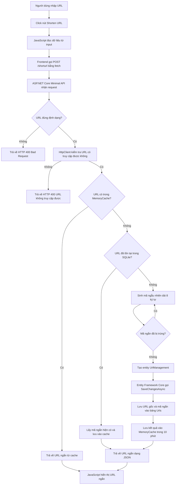
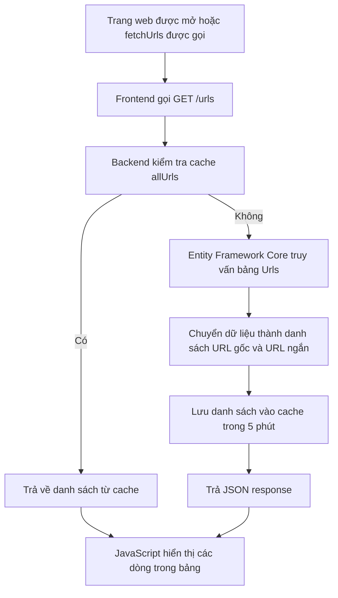
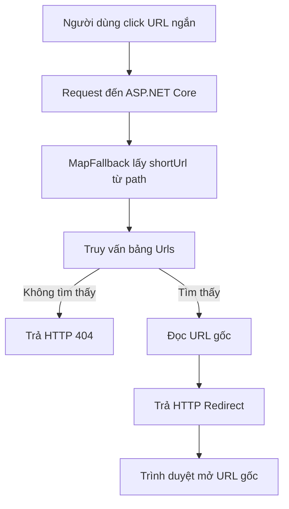

# UrlShort-AMD201

## 1. Giới thiệu dự án

**UrlShort-AMD201** là một ứng dụng rút gọn đường dẫn. Người dùng nhập một URL dài, hệ thống sẽ kiểm tra tính hợp lệ, tạo ra một mã ngắn, lưu mối liên hệ giữa URL gốc và mã ngắn vào database. Khi người dùng truy cập mã ngắn, hệ thống sẽ chuyển hướng họ đến URL ban đầu.

### Chức năng chính

- Rút gọn URL.
- Kiểm tra URL có đúng định dạng và có thể truy cập hay không.
- Kiểm tra URL đã tồn tại để tránh tạo bản ghi không cần thiết.
- Sinh mã URL ngắn ngẫu nhiên và kiểm tra trùng lặp.
- Hiển thị danh sách các URL đã rút gọn.
- Xóa URL rút gọn.
- Chuyển hướng từ URL ngắn sang URL gốc.
- Sử dụng cache để giảm số lần truy vấn database.
- Hỗ trợ chạy ứng dụng bằng Docker/Docker Compose.

## 2. Công nghệ sử dụng

- **Backend:** C#, ASP.NET Core 8 Minimal API.
- **ORM:** Entity Framework Core 8.
- **Database:** SQLite, lưu trong file `app.db`.
- **Frontend:** HTML, CSS và JavaScript thuần.
- **API communication:** JavaScript `fetch()`.
- **Caching:** ASP.NET Core `IMemoryCache`.
- **API documentation:** Swagger/OpenAPI.
- **HTTP client:** `IHttpClientFactory` để kiểm tra khả năng truy cập của URL.
- **Containerization:** Docker và Docker Compose.

Dự án sử dụng .NET 8.0. Mặc dù project có tham chiếu đến package SQL Server và StackExchange.Redis, cấu hình hiện tại đang sử dụng **SQLite** cho database và **IMemoryCache** cho caching.

## 3. Vai trò trong dự án

Trong dự án, tôi đảm nhiệm vai trò **Full-stack Developer**, bao gồm:

- Thiết kế giao diện người dùng bằng HTML/CSS.
- Viết JavaScript để nhận dữ liệu và gọi API backend.
- Xây dựng các Minimal API endpoint bằng ASP.NET Core.
- Thiết kế model `UrlManagement`.
- Kết nối và thao tác với SQLite thông qua Entity Framework Core.
- Xử lý logic sinh mã URL ngắn, kiểm tra trùng lặp và redirect.
- Triển khai cơ chế cache với `IMemoryCache`.
- Đóng gói và cấu hình chạy ứng dụng bằng Docker.

## 4. Bài toán thực tế và các chức năng đã thực hiện

### 4.1. Rút gọn URL

API `POST /shorturl` thực hiện các bước:

1. Nhận URL từ giao diện frontend.
2. Kiểm tra URL có rỗng hoặc sai định dạng hay không.
3. Kiểm tra URL có thể truy cập được bằng `HttpClient`.
4. Kiểm tra URL đã tồn tại trong cache hay chưa.
5. Nếu chưa có trong cache, kiểm tra tiếp trong database.
6. Nếu URL chưa tồn tại, sinh một chuỗi ngẫu nhiên dài 8 ký tự.
7. Kiểm tra mã ngắn có bị trùng trong database không.
8. Lưu URL gốc và mã ngắn vào bảng `Urls`.
9. Trả về URL ngắn cho frontend.
10. Lưu kết quả vào cache trong 10 phút.

### 4.2. Hiển thị danh sách URL

API `GET /urls` lấy danh sách các URL đã lưu trong database. Kết quả được lưu vào cache trong 5 phút nhằm giảm số lần truy vấn database khi người dùng tải lại danh sách.

### 4.3. Xóa URL

API `DELETE /delete/{shortUrl}` thực hiện:

- Tìm bản ghi theo mã URL ngắn.
- Xóa bản ghi khỏi database.
- Xóa cache của URL tương ứng.
- Xóa cache danh sách tất cả URL để tránh hiển thị dữ liệu cũ.

### 4.4. Redirect URL ngắn

Khi người dùng truy cập URL có dạng `/{shortUrl}`, backend sẽ tìm mã ngắn trong database. Nếu tìm thấy, hệ thống trả về HTTP Redirect đến URL gốc. Nếu không tìm thấy, hệ thống trả về lỗi 404.

## 5. Phần khó nhất và cách giải quyết

Phần khó nhất là sinh mã URL ngắn nhưng vẫn đảm bảo mã đó không bị trùng.

Cách giải quyết:

- Sử dụng bộ ký tự gồm chữ hoa, chữ thường và chữ số.
- Sinh chuỗi ngẫu nhiên có độ dài mặc định 8 ký tự.
- Truy vấn database để kiểm tra mã vừa sinh.
- Nếu mã đã tồn tại, sinh lại mã mới cho đến khi tìm được mã chưa sử dụng.
- Sau đó mới tạo entity và gọi `SaveChangesAsync()` để lưu dữ liệu.

Một vấn đề khác là khi người dùng nhập lại cùng một URL. Hệ thống kiểm tra cache trước, sau đó kiểm tra database. Nếu URL đã tồn tại, hệ thống trả về mã cũ thay vì tạo thêm một bản ghi mới.

Ngoài ra, khi xóa URL, cần xóa cả dữ liệu liên quan trong cache. Nếu chỉ xóa database mà không xóa cache, danh sách trên giao diện có thể vẫn hiển thị dữ liệu cũ.

## 6. Mô hình dữ liệu

Bảng `Urls` được ánh xạ từ model `UrlManagement`:

| Trường | Kiểu dữ liệu | Ý nghĩa |
|---|---|---|
| `Id` | `int` | Khóa chính, tự tăng |
| `Url` | `string` | URL gốc |
| `ShortUrl` | `string` | Mã URL ngắn |

Ví dụ dữ liệu:

| Id | Url | ShortUrl |
|---:|---|---|
| 1 | `https://example.com/very-long-path` | `AbC123xy` |

## 7. Luồng dữ liệu

### 7.1. Luồng tạo URL ngắn



### 7.2. Luồng tải danh sách URL



### 7.3. Luồng xóa URL

```mermaid
flowchart TD
    A[Người dùng click Delete] --> B[JavaScript lấy shortUrl]
    B --> C[Frontend gọi DELETE /delete/{shortUrl}]
    C --> D[Backend tìm bản ghi trong SQLite]
    D -- Không tìm thấy --> E[Trả HTTP 404]
    D -- Tìm thấy --> F[Xóa entity khỏi DbContext]
    F --> G[SaveChangesAsync lưu thay đổi]
    G --> H[Xóa cache của URL]
    H --> I[Xóa cache allUrls]
    I --> J[Trả kết quả xóa thành công]
    J --> K[Frontend gọi lại GET /urls]
```

### 7.4. Luồng redirect



## 8. Cách chạy dự án

### Chạy trực tiếp bằng .NET

Yêu cầu:

- .NET SDK 8.0.
- Visual Studio 2022 hoặc JetBrains Rider, tùy môi trường phát triển.

Chạy lệnh:

```bash
dotnet restore
dotnet run --project UrlShort/UrlShort.csproj
```

Sau khi chạy, mở địa chỉ được hiển thị trong terminal. Ở môi trường phát triển, Swagger có thể được sử dụng để kiểm thử API.

### Chạy bằng Docker Compose

Từ thư mục `UrlShort`, chạy:

```bash
docker compose up --build
```

Docker Compose sẽ build ứng dụng, expose các port đã cấu hình và mount file `app.db` để lưu dữ liệu SQLite.

## 9. Các API chính

| Method | Endpoint | Mô tả |
|---|---|---|
| `POST` | `/shorturl` | Tạo hoặc lấy URL ngắn cho URL gốc |
| `GET` | `/urls` | Lấy danh sách URL đã rút gọn |
| `DELETE` | `/delete/{shortUrl}` | Xóa URL theo mã ngắn |
| `GET` | `/{shortUrl}` | Redirect đến URL gốc |

### Ví dụ request tạo URL ngắn

```json
{
  "url": "https://example.com/very-long-path"
}
```

### Ví dụ response

```json
{
  "url": "http://localhost:5258/AbC123xy"
}
```

## 10. Hướng phát triển

Nếu triển khai cho môi trường thực tế hoặc số lượng người dùng lớn hơn, có thể cải thiện thêm:

- Chuyển từ SQLite sang PostgreSQL hoặc SQL Server.
- Chuyển từ `IMemoryCache` sang Redis để chia sẻ cache giữa nhiều instance.
- Thêm unique index cho trường `ShortUrl`.
- Thêm authentication và phân quyền người dùng.
- Thêm rate limiting để hạn chế spam API.
- Thêm thống kê số lượt click cho từng URL.
- Thêm thời gian hết hạn cho URL ngắn.
- Tách code thành các lớp Controller/Service/Repository để dễ bảo trì.
- Bổ sung unit test, integration test và logging.

## 11. Cách trình bày dự án trong phỏng vấn

> Dự án em muốn trình bày là UrlShort-AMD201, một ứng dụng rút gọn URL. Mục tiêu của dự án là giúp người dùng biến một đường dẫn dài thành một đường dẫn ngắn và sử dụng đường dẫn đó để redirect về URL ban đầu.
>
> Em sử dụng ASP.NET Core 8 Minimal API, C#, Entity Framework Core, SQLite, HTML, CSS, JavaScript và Docker. Em đảm nhiệm phần full-stack, từ giao diện, API, model, database đến logic sinh mã URL và redirect.
>
> Với chức năng tạo URL ngắn, frontend gửi request POST đến backend. Backend kiểm tra định dạng và khả năng truy cập của URL, kiểm tra cache và database. Nếu URL chưa tồn tại, hệ thống sinh mã ngẫu nhiên dài 8 ký tự, kiểm tra trùng rồi lưu URL gốc và mã ngắn vào bảng Urls. Sau đó backend trả kết quả về frontend để hiển thị cho người dùng.
>
> Phần khó nhất là đảm bảo mã ngắn không bị trùng và xử lý trường hợp người dùng nhập lại cùng một URL. Em giải quyết bằng cách kiểm tra mã trước khi lưu, đồng thời kiểm tra cache và database để có thể trả lại mã cũ nếu URL đã tồn tại. Em cũng xóa các cache liên quan khi xóa URL để dữ liệu hiển thị luôn chính xác.
