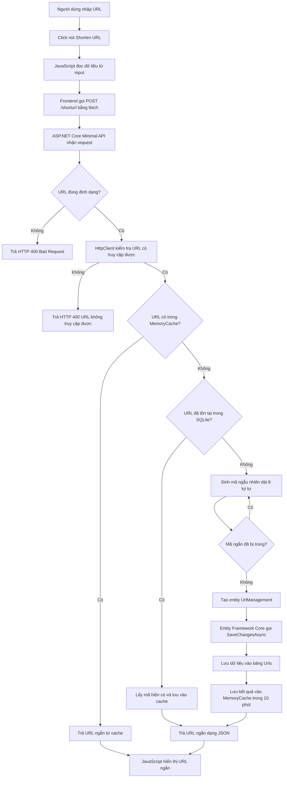
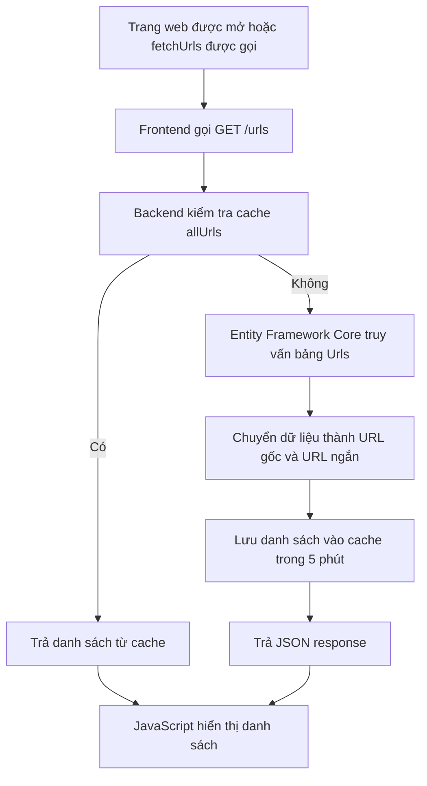
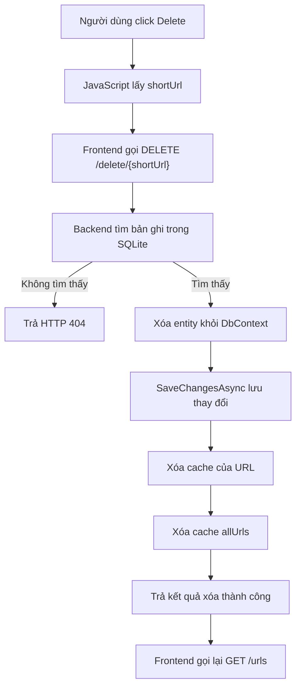
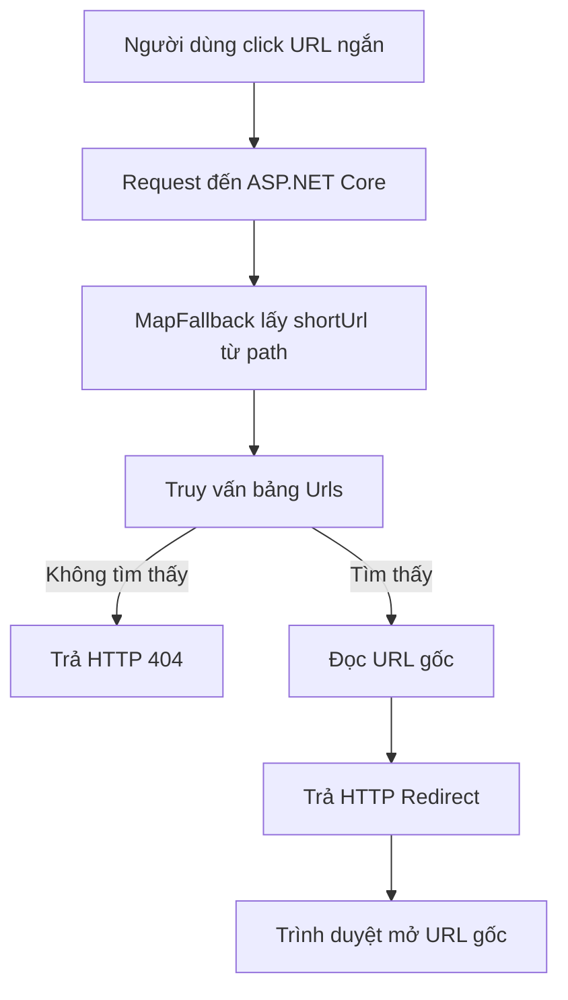

# UrlShort-AMD201

## 1. Giới thiệu dự án

**UrlShort-AMD201** là ứng dụng rút gọn URL. Người dùng nhập một URL dài, hệ thống kiểm tra tính hợp lệ, tạo mã ngắn, lưu URL gốc cùng mã ngắn vào database và redirect về URL ban đầu khi mã ngắn được truy cập.

### Chức năng chính

- Rút gọn URL.
- Kiểm tra URL đúng định dạng và có thể truy cập.
- Tránh tạo bản ghi trùng khi người dùng nhập lại cùng URL.
- Sinh mã URL ngắn và kiểm tra trùng lặp.
- Hiển thị danh sách URL đã rút gọn.
- Xóa URL rút gọn.
- Redirect từ URL ngắn về URL gốc.
- Sử dụng cache để giảm truy vấn database.
- Hỗ trợ Docker/Docker Compose.

## 2. Công nghệ sử dụng

- **Backend:** C#, ASP.NET Core 8 Minimal API.
- **ORM:** Entity Framework Core 8.
- **Database:** SQLite, lưu trong file `app.db`.
- **Frontend:** HTML, CSS và JavaScript thuần.
- **API communication:** JavaScript `fetch()`.
- **Caching:** ASP.NET Core `IMemoryCache`.
- **API documentation:** Swagger/OpenAPI.
- **HTTP client:** `IHttpClientFactory` để kiểm tra URL.
- **Containerization:** Docker và Docker Compose.

Dự án target .NET 8.0. Mặc dù project có tham chiếu package SQL Server và StackExchange.Redis, cấu hình hiện tại sử dụng SQLite và `IMemoryCache`.

## 3. Vai trò trong dự án

Tôi đảm nhiệm vai trò **Full-stack Developer**, bao gồm:

- Thiết kế giao diện HTML/CSS.
- Viết JavaScript gọi API bằng `fetch()`.
- Xây dựng Minimal API bằng ASP.NET Core.
- Thiết kế model `UrlManagement`.
- Kết nối SQLite bằng Entity Framework Core.
- Xử lý sinh mã URL, kiểm tra trùng lặp và redirect.
- Triển khai cache với `IMemoryCache`.
- Đóng gói ứng dụng bằng Docker.

## 4. Bài toán thực tế và chức năng đã thực hiện

### 4.1. Rút gọn URL

API `POST /shorturl` thực hiện:

1. Nhận URL từ frontend.
2. Kiểm tra URL rỗng hoặc sai định dạng.
3. Kiểm tra URL có thể truy cập bằng `HttpClient`.
4. Kiểm tra URL trong cache.
5. Kiểm tra URL trong database nếu cache không có.
6. Sinh chuỗi ngẫu nhiên dài 8 ký tự nếu URL chưa tồn tại.
7. Kiểm tra mã ngắn có bị trùng không.
8. Lưu URL gốc và mã ngắn vào bảng `Urls`.
9. Trả URL ngắn về frontend.
10. Lưu kết quả vào cache trong 10 phút.

### 4.2. Hiển thị danh sách URL

API `GET /urls` lấy danh sách URL đã lưu. Kết quả được cache trong 5 phút để giảm số lần truy vấn database.

### 4.3. Xóa URL

API `DELETE /delete/{shortUrl}` tìm bản ghi theo mã ngắn, xóa bản ghi trong database, đồng thời xóa cache của URL và cache danh sách URL.

### 4.4. Redirect URL ngắn

Khi người dùng truy cập đường dẫn dạng `/{shortUrl}`, backend tìm mã ngắn trong database. Nếu tìm thấy, hệ thống trả về HTTP Redirect đến URL gốc; nếu không tìm thấy, trả về lỗi 404.

## 5. Phần khó nhất và cách giải quyết

Phần khó nhất là sinh mã URL ngắn nhưng vẫn đảm bảo mã không bị trùng.

Cách giải quyết:

- Sử dụng chữ hoa, chữ thường và chữ số.
- Sinh chuỗi ngẫu nhiên mặc định dài 8 ký tự.
- Truy vấn database để kiểm tra mã vừa sinh.
- Nếu mã đã tồn tại, sinh lại mã mới.
- Chỉ lưu entity sau khi tìm được mã chưa sử dụng.

Với trường hợp người dùng nhập lại cùng URL, hệ thống kiểm tra cache trước rồi kiểm tra database. Nếu URL đã tồn tại, hệ thống trả lại mã cũ thay vì tạo bản ghi mới.

Khi xóa URL, hệ thống cũng xóa các cache liên quan để tránh giao diện hiển thị dữ liệu cũ.

## 6. Mô hình dữ liệu

Bảng `Urls` được ánh xạ từ model `UrlManagement`:

| Trường | Kiểu dữ liệu | Ý nghĩa |
|---|---|---|
| `Id` | `int` | Khóa chính, tự tăng |
| `Url` | `string` | URL gốc |
| `ShortUrl` | `string` | Mã URL ngắn |

Ví dụ:

| Id | Url | ShortUrl |
|---:|---|---|
| 1 | `https://example.com/very-long-path` | `AbC123xy` |

## 7. Luồng dữ liệu

### 7.1. Luồng tạo URL ngắn



### 7.2. Luồng tải danh sách URL



### 7.3. Luồng xóa URL



### 7.4. Luồng redirect



## 8. Cách chạy dự án

### Chạy trực tiếp bằng .NET

Yêu cầu .NET SDK 8.0. Chạy từ thư mục gốc repository:

```bash
dotnet restore
dotnet run --project UrlShort/UrlShort.csproj
```

### Chạy bằng Docker Compose

Từ thư mục `UrlShort`, chạy:

```bash
docker compose up --build
```

Docker Compose sẽ build ứng dụng, expose các port đã cấu hình và mount file `app.db` để lưu dữ liệu SQLite.

## 9. Các API chính

| Method | Endpoint | Mô tả |
|---|---|---|
| `POST` | `/shorturl` | Tạo hoặc lấy URL ngắn cho URL gốc |
| `GET` | `/urls` | Lấy danh sách URL đã rút gọn |
| `DELETE` | `/delete/{shortUrl}` | Xóa URL theo mã ngắn |
| `GET` | `/{shortUrl}` | Redirect đến URL gốc |

### Request mẫu

```json
{
  "url": "https://example.com/very-long-path"
}
```

### Response mẫu

```json
{
  "url": "http://localhost:5258/AbC123xy"
}
```

## 10. Hướng phát triển

- Chuyển từ SQLite sang PostgreSQL hoặc SQL Server.
- Chuyển từ `IMemoryCache` sang Redis khi chạy nhiều instance.
- Thêm unique index cho trường `ShortUrl`.
- Thêm authentication và phân quyền.
- Thêm rate limiting.
- Thêm thống kê số lượt click.
- Thêm thời gian hết hạn cho URL ngắn.
- Tách code thành Controller/Service/Repository.
- Bổ sung unit test, integration test và logging.

## 11. Cách trình bày trong phỏng vấn

> Dự án em muốn trình bày là UrlShort-AMD201, một ứng dụng rút gọn URL. Mục tiêu là biến một đường dẫn dài thành đường dẫn ngắn và redirect về URL ban đầu.
>
> Em sử dụng ASP.NET Core 8 Minimal API, C#, Entity Framework Core, SQLite, HTML, CSS, JavaScript và Docker. Em đảm nhiệm phần full-stack, từ giao diện, API, model, database đến logic sinh mã URL và redirect.
>
> Khi người dùng gửi URL, frontend gọi `POST /shorturl`. Backend kiểm tra định dạng, khả năng truy cập, cache và database. Nếu URL chưa tồn tại, hệ thống sinh mã ngẫu nhiên dài 8 ký tự, kiểm tra trùng rồi lưu URL gốc và mã ngắn vào bảng `Urls`. Sau đó backend trả kết quả về frontend.
>
> Phần khó nhất là đảm bảo mã ngắn không bị trùng và xử lý trường hợp người dùng nhập lại cùng URL. Em giải quyết bằng cách kiểm tra mã trước khi lưu, kiểm tra cache/database để trả lại mã cũ và xóa cache liên quan khi xóa URL.
